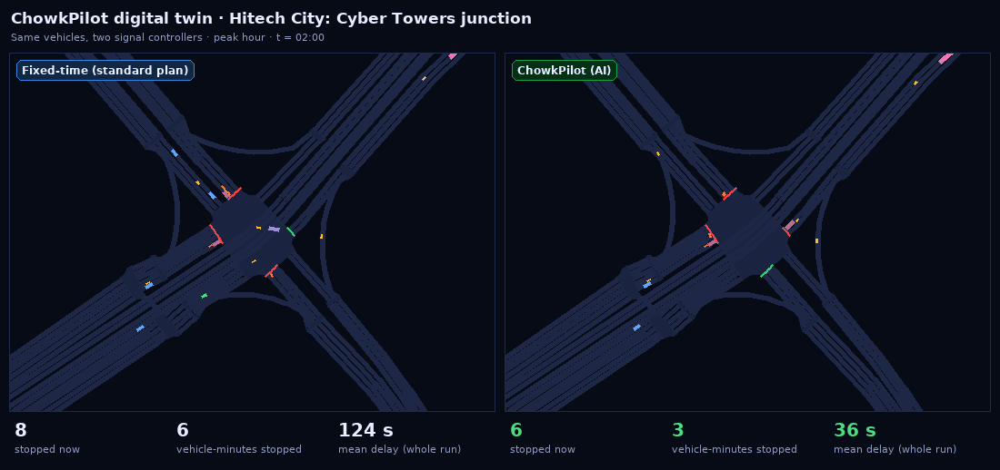
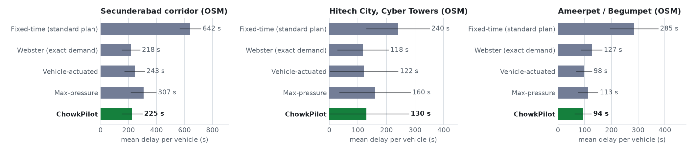
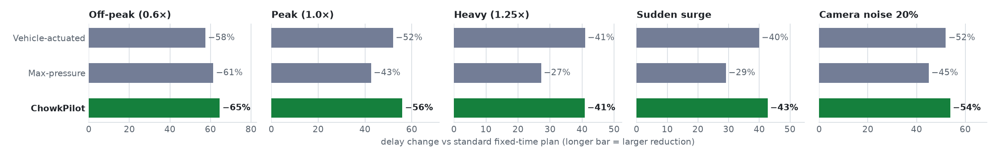
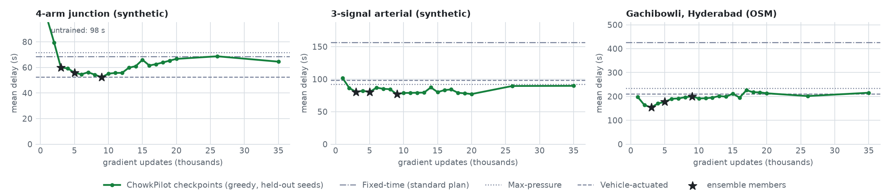
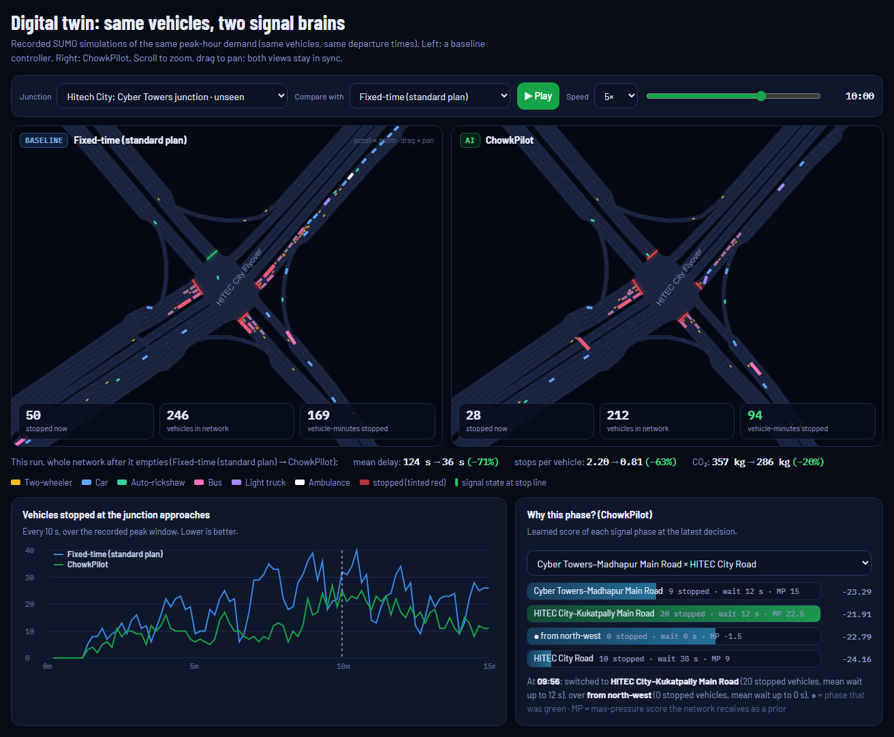
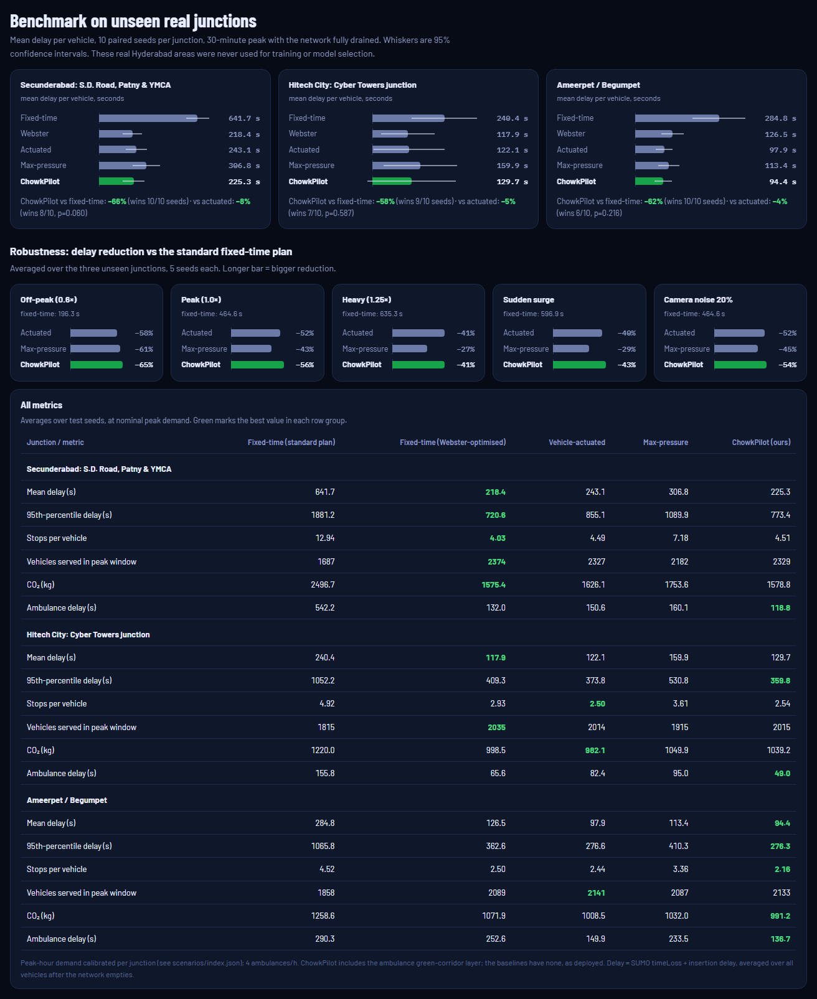
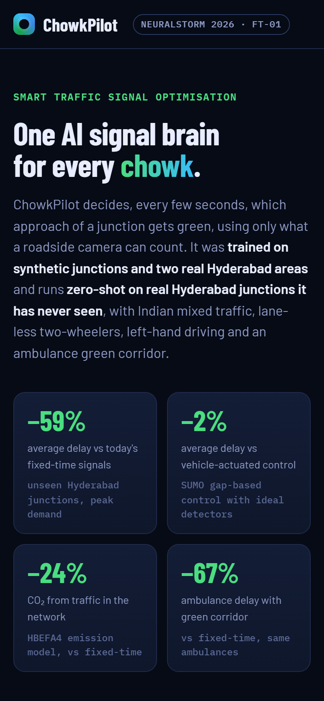

# ChowkPilot 🚦 One AI signal brain for every *chowk*

[](https://github.com/AbderrahmaneTB/chowkpilot/actions/workflows/tests.yml)

**NeuralStorm 2026 · Track 1 Future Tech · Problem statement FT-01: Smart Traffic Signal Optimisation**<br>
**Team Blackwater:** Abderrahmane Tayeb Boudjema ([@AbderrahmaneTB](https://github.com/AbderrahmaneTB)) · Ouail Imad Eddine Zitouni ([@WaelYTz](https://github.com/WaelYTz))

**[▶ Live demo (digital twin control room)](https://abderrahmanetb.github.io/chowkpilot/)** · **[🎬 2.5-minute narrated walkthrough](https://abderrahmanetb.github.io/chowkpilot/img/chowkpilot_walkthrough.mp4)** · [How it works](#how-it-works) · [Results](#results) · [Run it yourself](#run-it-yourself)

<!-- RESULTS-HERO -->
> **Results on three real Hyderabad areas never seen in training** (10 paired seeds per junction, averaged over the areas):
> - Mean delay per vehicle **59% lower** than the standard fixed-time plan (better at all 3 junctions, p < 0.05)
> - **21% lower** than max-pressure control (significantly better at 2 of 3 junctions)
> - **2% lower** than vehicle-actuated control (no junction-level difference is significant)
> - **4% lower** than a Webster plan re-timed with each run’s exact demand (significantly better at 1 of 3 junctions)
> - CO₂ is **24% lower** than with fixed-time and ambulance delay is **67% lower** than with fixed-time
> - Lowest mean delay of the five controllers at 1 of 3 areas. At the other 2, the lowest mean delay belongs to Fixed-time (Webster-optimised).
<!-- /RESULTS-HERO -->

ChowkPilot is a reinforcement-learning traffic-signal controller built for Indian junctions. Every few
seconds it decides which approach gets green, using only what a roadside camera can count. One small
learned policy (three 30k-parameter networks whose scores are averaged) drives **any** junction layout: 3-arm, 4-arm, 5-arm, or a joined
OpenStreetMap cluster with any number of phases. It was trained on synthetic junctions and two real
Hyderabad areas, then evaluated **zero-shot on three real Hyderabad areas it never saw**, in a
simulator configured for Indian traffic: lane-less two-wheelers, autos, buses, left-hand driving and
assertive merging.

<p align="center"></p>
<p align="center"><sub>Real SUMO output, not an animation: the same peak-hour vehicles at the unseen Hitech City junction under the standard fixed-time plan (left) and ChowkPilot (right). One recorded run (seed 3); the averages over 10 seeds are in <a href="#results">Results</a>. Stopped vehicles are tinted red.</sub></p>

---

## The problem

- Indian cities are among the most congested in the world. In the 2026 TomTom Traffic Index (2025 data),
  **Bengaluru ranks #2 worldwide** (36 min 9 s per 10 km, 168 hours lost per year in rush hour).
  **Hyderabad** drivers need 32 min 37 s per 10 km and lose **123 hours a year** in rush hour.
  ([TomTom Traffic Index](https://www.tomtom.com/traffic-index/city/hyderabad/))
- Congestion costs Delhi, Mumbai, Bengaluru and Kolkata up to **USD 22 billion a year**
  ([BCG, *Unlocking Cities*, 2018](https://web-assets.bcg.com/img-src/BCG-Unlocking-Cities-Ridesharing-India_tcm9-185213.pdf)).
- Traffic is **mixed and lane-less**: **73.4%** of Telangana's registered vehicles are motorcycles
  ([Telangana Transport Department, 31 Mar 2025](https://transport.telangana.gov.in/html/statistics_vehicles.html)).
  Controllers tuned on lane-disciplined Western car traffic don't match this stream.
- Most signals still run **fixed-time plans**. Hyderabad's adaptive programme covers 122 junctions alongside
  213 older HTRIMS signals ([Telangana Today, 2022](https://telanganatoday.com/new-traffic-signal-system-in-hyderabad)).
  Commercial adaptive systems typically need dedicated detectors, licences and per-junction tuning.
- Emergency vehicles lose minutes at red lights: Delhi's average ambulance response time has risen above
  17 minutes ([The Hindu, 2025](https://www.thehindu.com/sci-tech/health/reclaiming-the-golden-hour-how-technology-can-help-beat-urban-traffic-and-save-lives/article69678684.ece)).

**What existing approaches miss**

| Approach | Limitation | ChowkPilot |
|---|---|---|
| Fixed-time plans (most Indian signals) | Can't react to demand; plans go stale | Re-decides every 5 s from live counts |
| Vehicle-actuated / gap-based | Built for loop detectors and gaps between vehicles; dense two-wheeler streams rarely leave clean gaps | Uses queue, flow, waiting time and spillback from camera zones |
| Max-pressure (Varaiya, 2013) | Hand-written score, ignores waiting time, approaching platoons and switching cost | Keeps max-pressure's structure and *learns* the score |
| RL controllers (PressLight, CoLight, …) | Usually trained and evaluated on the same synthetic grid or city map, with lane-disciplined traffic | Shares weights across movements and phases (in the spirit of FRAP and MPLight) for *any* phase set, and is tested zero-shot on unseen real junctions with Indian mixed traffic |
| Timing-advice systems (e.g. Google Green Light) | Offline plan suggestions; emissions modelled with a single vehicle type | Real-time control, evaluated on an Indian mixed-traffic stream |

## How it works

```
 OpenStreetMap ──► SUMO digital twin ──► camera zones (last 150 m per lane)
 (real junction)    left-hand, sublane       │  vehicles, stopped vehicles, occupancy, waiting time,
                    mixed traffic            │  arrivals in the last 50 m, gap since the last vehicle,
                                             │  exit-road spillback, ambulance flag
                                             ▼
            per-movement features ──► φ (shared MLP) ──► sum-pool over the movements each phase
                                                          releases / keeps waiting
                                                                    │   + max-pressure score (prior)
                                                                    ▼
                         safety layer ◄── argmax ◄── ψ (shared MLP): score Q(phase)
   min green 10 s · max green 60 s · max red 120 s · yellow 3 s · all-red 1 s · ambulance green corridor
```

### 1. Digital twins of real Hyderabad junctions
- `chowkpilot/scenarios/osm.py` downloads the main road network for a bounding box from OpenStreetMap
  (Overpass API) and converts it with SUMO `netconvert`, with **left-hand traffic**, signal guessing,
  joined junction clusters and street names kept.
- Test areas, never used in training: **Secunderabad** (S.D. Road, Rashtrapati Road, Sardar Patel Road; 5 signals),
  **Hitech City** (Cyber Towers / HITEC City Flyover junction) and **Ameerpet / Begumpet** (5 signals).
  Training areas: Gachibowli / Financial District and Abids / Nampally, plus 11 synthetic layouts
  (single junctions with 1 to 3 lanes, arterials, grids, a 5-arm spider network and random networks).
- **Indian mixed traffic** (`chowkpilot/scenarios/vtypes.py`): two-wheelers 52%, cars 27%, autos 12%,
  light trucks 5%, buses 4%, simulated with SUMO's **sublane model**. Two-wheelers and autos filter between
  cars and queue side by side at the stop line. Drivers merge assertively at unsignalised junctions
  (impatience, short minor-road gaps), as Indian traffic does.
- **Paired, seeded demand** (`chowkpilot/scenarios/demand.py`): every vehicle has its own departure time,
  type and route, so each controller faces *exactly the same vehicles*. Arrivals follow a
  time-of-day profile. Nominal (peak) demand is calibrated per junction to the onset of congestion under
  vehicle-actuated control (`chowkpilot/scenarios/calibrate.py`).

### 2. A junction abstraction that works for any layout
`chowkpilot/env/junction.py` reduces any SUMO signal to **movements** (incoming road → outgoing road),
**green phases** (the candidate actions) and a mask of which movements each phase releases. Controllers only
ever see per-movement features and this mask, which is why one set of weights can run junctions it has
never seen.

### 3. The learned max-pressure policy
Max-pressure gives each phase the score `Σ (vehicles in − vehicles out)` over the movements it releases, and
picks the highest. It comes with a proof of throughput optimality, but its score is hand-written. ChowkPilot keeps
that structure, takes the max-pressure score as an input, and **learns a correction to it**
(`chowkpilot/rl/policy.py`):

- `e_m = φ(features of movement m)`: 10 camera-zone features (stopped and moving vehicles, occupancy, mean
  waiting time, exit-road occupancy for spillback, ambulance flag, lane count, currently green, moving vehicles in
  the last 50 m, and seconds since a vehicle last crossed the stop line, the gap that actuated control reacts to).
- For each phase *p*: **sum**-pool `e_m` over the movements it releases and over the movements it keeps waiting,
  append 5 phase features (is current, time in green, time since last served, share of movements, max-pressure
  score), then `Q(p) = ψ(·)`. Each network has 30,337 parameters, and the same weights serve every junction.
- **Training** (`chowkpilot/rl/train.py`): Double DQN with a semi-Markov formulation. Each decision lasts until the
  junction's next decision point, and rewards are discounted per second. The reward is the ground-truth
  **delay rate** (Σ vehicles × (1 − v / v_max)) on the junction's approaches, plus half the delay on its exit
  roads, so a junction pays for the jams it pushes downstream. Ten SUMO worker processes stream experience to one
  learner on an NVIDIA GPU. Every episode randomises the layout, demand level, time-of-day profile, OD imbalance,
  ambulance rate and **camera noise**. Layouts are drawn with weight (junctions)^−0.5 (`--balance 0.5`), so isolated
  junctions are not crowded out of the replay buffer by the 9-junction grids. Exploration mixes random phases with
  max-pressure actions. A checkpoint is saved every 1,000 updates.
- **Selection, on validation only** (`chowkpilot/rl/select.py`, `models/selection.json`):
  1. Every early checkpoint is scored on training layouts with held-out seeds, by delay relative to actuated control.
  2. The 3 best are re-run on 3 more seeds.
  3. The deployed policy is their **ensemble**, which averages the three networks' phase scores (91,011 parameters
     in total).

  Before release it was compared with our previous model (`models/run4/`) on 3 fresh seeds that nothing else had
  used. It scored 0.853 against 0.898, where 1.0 means level with actuated control (`tools/head_to_head.py`,
  `models/head_to_head.json`).
- **Deployment form**: pure NumPy inference (`NumpyPolicy`), no PyTorch: about 0.16 ms per decision for the
  three-network ensemble on a laptop CPU (measured).

**Three failures we found and fixed (all visible in the git history):**
1. *Mean pooling starves arterials.* Our first scorer averaged over a phase's released movements. On a 3-signal
   arterial it learned to hold protected right-turn phases (2 congested turn bays looked as valuable as 6 busy
   through movements), and traffic gridlocked: 244 vehicles were still stuck 20 minutes after demand ended. Max-pressure
   sums, so we switched to sum pooling and gave the network the max-pressure score as a prior.
2. *Max-green is not enough for safety.* A policy can alternate between two phases forever and starve a third. We
   added a max-red guarantee (below) that holds for every controller.
3. *Longer training made the policy worse.* Every run peaked within its first few thousand updates and then drifted.
   In the deployed run, validation went from 0.89 to 1.02 within 10 minutes, and a lower learning rate only slowed
   the drift. So we save dense early checkpoints and choose on validation instead of taking the last one.

### 4. Safety layer and ambulance green corridor
Every adaptive controller, learned or not, acts through the same state machine in `chowkpilot/env/sim.py`, which
enforces the constraints whatever the controller requests:

- minimum green 10 s and maximum green 60 s; yellow 3 s, then all-red 1 s;
- **max red**: a movement with stopped vehicles gets green within 120 s;
- **ambulance green corridor**: an ambulance detected within 150 m of a stop line gets its phase after 5 s of green
  on the current phase (or keeps its green).

The unit tests attack this layer with an adversarial random controller and check every invariant
(`tests/test_core.py`).

## Results

<!-- RESULTS -->
All numbers below are produced by `python -m chowkpilot.eval.benchmark --seeds 10` and stored per run in [`results/benchmark.json`](results/benchmark.json). Each junction is simulated for a 30-minute peak (time-of-day profile, 4 ambulances/h) and then run until the network empties. **Delay** = SUMO time loss plus waiting-to-enter time, averaged over every vehicle. Seeds are **paired**: every controller sees exactly the same vehicles.

<picture><source media="(prefers-color-scheme: dark)" srcset="docs/img/benchmark-dark.png"></picture>

### Reading the results

ChowkPilot has the lowest mean delay on **1 of 3** unseen junctions.

- **Secunderabad: S.D. Road, Patny & YMCA:** −66.0% delay vs fixed-time (p<0.001), −8.2% vs vehicle-actuated (p=0.060). Fixed-time (Webster-optimised) is best here (218.4 s vs ChowkPilot's 225.3 s).
- **Hitech City: Cyber Towers junction:** −58.2% delay vs fixed-time (p=0.001), −4.8% vs vehicle-actuated (p=0.587). Fixed-time (Webster-optimised) is best here (117.9 s vs ChowkPilot's 129.7 s).
- **Ameerpet / Begumpet:** −62.4% delay vs fixed-time (p<0.001), −4.4% vs vehicle-actuated (p=0.216). Lowest mean delay of the five controllers (94.4 s).

The Webster baseline is re-timed for every run from that run's exact demand, which a city cannot know in advance, so it is an upper bound for a fixed-time plan. Vehicle-actuated control uses ideal loop detectors.

### Mean delay per vehicle (seconds, mean ± 95% CI)

| Junction (unseen in training) | Fixed-time (standard plan) | Fixed-time (Webster-optimised) | Vehicle-actuated | Max-pressure | **ChowkPilot** |
|---|---:|---:|---:|---:|---:|
| Secunderabad: S.D. Road, Patny & YMCA | 641.7 ± 73.8 | **218.4 ± 63.1** | 243.1 ± 70.3 | 306.8 ± 89.6 | 225.3 ± 71.7 |
| Hitech City: Cyber Towers junction | 240.4 ± 109.4 | **117.9 ± 88.6** | 122.1 ± 118.2 | 159.9 ± 123.3 | 129.7 ± 147.9 |
| Ameerpet / Begumpet | 284.8 ± 89.8 | 126.5 ± 37.8 | 97.9 ± 28.0 | 113.4 ± 35.7 | **94.4 ± 30.2** |

### ChowkPilot vs each baseline (paired by seed)

| Junction | vs Fixed-time (standard plan) | vs Fixed-time (Webster-optimised) | vs Vehicle-actuated | vs Max-pressure |
|---|---:|---:|---:|---:|
| Secunderabad: S.D. Road, Patny & YMCA | −66.0% (wins 10/10, p<0.001) | +1.2% (wins 3/10, p=0.429) | −8.2% (wins 8/10, p=0.060) | −27.1% (wins 10/10, p<0.001) |
| Hitech City: Cyber Towers junction | −58.2% (wins 9/10, p=0.001) | −10.7% (wins 8/10, p=0.673) | −4.8% (wins 7/10, p=0.587) | −29.8% (wins 9/10, p=0.134) |
| Ameerpet / Begumpet | −62.4% (wins 10/10, p<0.001) | −25.1% (wins 10/10, p<0.001) | −4.4% (wins 6/10, p=0.216) | −16.1% (wins 10/10, p=0.002) |

### Other metrics (mean over seeds)

| Junction | Metric | Fixed-time (standard plan) | Fixed-time (Webster-optimised) | Vehicle-actuated | Max-pressure | **ChowkPilot** |
|---|---|---:|---:|---:|---:|---:|
| Secunderabad: S.D. Road, Patny & YMCA | 95th-percentile delay (s) | 1881.2 | **720.6** | 855.1 | 1089.9 | 773.4 |
|  | Stops per vehicle | 12.94 | **4.03** | 4.49 | 7.18 | 4.51 |
|  | CO₂ in the network (kg) | 2496.7 | **1575.4** | 1626.1 | 1753.6 | 1578.8 |
|  | Fuel (kg) | 807.4 | **509.2** | 525.6 | 566.9 | 510.3 |
|  | Vehicles served during the peak | 1687 | **2374** | 2327 | 2182 | 2329 |
|  | Ambulance delay (s) | 542.2 | 132.0 | 150.6 | 160.1 | **118.8** |
| Hitech City: Cyber Towers junction | 95th-percentile delay (s) | 1052.2 | 409.3 | 373.8 | 530.8 | **359.8** |
|  | Stops per vehicle | 4.92 | 2.93 | **2.50** | 3.61 | 2.54 |
|  | CO₂ in the network (kg) | 1220.0 | 998.5 | **982.1** | 1049.9 | 1039.2 |
|  | Fuel (kg) | 394.4 | 322.7 | **317.4** | 339.4 | 335.9 |
|  | Vehicles served during the peak | 1815 | **2035** | 2014 | 1914 | 2014 |
|  | Ambulance delay (s) | 155.8 | 65.6 | 82.4 | 95.0 | **49.0** |
| Ameerpet / Begumpet | 95th-percentile delay (s) | 1065.8 | 362.6 | 276.6 | 410.3 | **276.3** |
|  | Stops per vehicle | 4.52 | 2.50 | 2.44 | 3.36 | **2.16** |
|  | CO₂ in the network (kg) | 1258.6 | 1071.9 | 1008.5 | 1032.0 | **991.2** |
|  | Fuel (kg) | 406.9 | 346.4 | 325.9 | 333.5 | **320.3** |
|  | Vehicles served during the peak | 1858 | 2089 | **2140** | 2087 | 2133 |
|  | Ambulance delay (s) | 290.3 | 252.6 | 149.9 | 233.5 | **136.7** |

### What that means on the street

Per simulated peak period (30 minutes of arrivals, run until the network empties), compared with the standard fixed-time plan:

| Junction | Vehicles | Vehicle-hours of delay saved | vs actuated | CO₂ saved (kg) | Fuel saved (kg) |
|---|---:|---:|---:|---:|---:|
| Secunderabad: S.D. Road, Patny & YMCA | 3035 | 351.0 | 15.0 | 917.9 | 297.1 |
| Hitech City: Cyber Towers junction | 2407 | 74.1 | -5.1 | 180.7 | 58.5 |
| Ameerpet / Begumpet | 2452 | 129.7 | 2.4 | 267.4 | 86.5 |

### Robustness: change in mean delay vs the standard fixed-time plan

<picture><source media="(prefers-color-scheme: dark)" srcset="docs/img/robustness-dark.png"></picture>

| Condition | Vehicle-actuated | Max-pressure | **ChowkPilot** | Fixed-time mean delay |
|---|---:|---:|---:|---:|
| Off-peak (0.6×) | −57.5% | −61.4% | **−64.6%** | 196 s |
| Peak (1.0×) | −52.0% | −42.6% | **−56.0%** | 465 s |
| Heavy (1.25×) | **−40.9%** | −27.2% | −40.8% | 635 s |
| Sudden surge | −39.9% | −29.1% | **−42.7%** | 597 s |
| Camera noise 20% | −52.0% | −45.0% | **−53.8%** | 465 s |

Averaged over the three unseen junctions, 5 seeds each (seeds 101 onwards, disjoint from the main benchmark). *Camera noise* adds 20% multiplicative count error and drops 10% of vehicles from the camera counts that ChowkPilot and max-pressure see; fixed-time needs no detection and SUMO's actuated controller keeps ideal loop detectors, so noise favours those baselines.

### Ablation: ambulance green corridor

| Junction | Ambulance delay, ChowkPilot without corridor | with corridor | Mean delay of all traffic, without | with |
|---|---:|---:|---:|---:|
| Secunderabad: S.D. Road, Patny & YMCA | 137.5 s | 118.8 s | 229.2 s | 225.3 s |
| Hitech City: Cyber Towers junction | 75.2 s | 49.0 s | 129.8 s | 129.7 s |
| Ameerpet / Begumpet | 162.5 s | 136.7 s | 93.6 s | 94.4 s |

### Learning curve

<picture><source media="(prefers-color-scheme: dark)" srcset="docs/img/learning_curve-dark.png"></picture>

Greedy validation of each checkpoint on training layouts with held-out seeds (10.0 minutes of training, 10 SUMO workers, learner on an NVIDIA GPU, 234,643 decisions collected, 45,950 gradient updates). The deployed policy is an ensemble of checkpoints `u003000.npz`, `u005000.npz`, `u009000.npz` (it averages their phase scores), the best by validation delay relative to vehicle-actuated control (score 0.896; [`models/selection.json`](models/selection.json)). The real test junctions were never used for training, validation or model selection.

<!-- /RESULTS -->

## Live demo

**https://abderrahmanetb.github.io/chowkpilot/** is a static control room that replays recorded SUMO
simulations side by side (same vehicles, baseline vs ChowkPilot):

- **Digital twin:** real road geometry, vehicles coloured by type, signal state at every stop line, synchronised
  zoom and pan, and live counters for stopped vehicles and vehicle-minutes lost.
- **Why this phase?** ChowkPilot's learned score for every phase at each decision, labelled with real street
  names, so you can see its reasoning.
- **Benchmark:** the full results on the unseen junctions, with confidence intervals.
- **Stress-test:** recorded runs under off-peak, heavy, surge and camera-noise conditions.

To run *new* simulations from the browser, start the local server (below) and the same page shows a live
simulation form.

<!-- SCREENSHOTS -->


<table><tr>
<td width="70%"></td>
<td width="30%"></td>
</tr></table>
<!-- /SCREENSHOTS -->

## From simulation to a Hyderabad junction

**What already fits a real deployment**

- **Compute:** about 0.16 ms per decision on a laptop CPU, so one small edge computer per junction, or one server
  per corridor, is enough. Inference needs no GPU.
- **Inputs:** per-lane counts in the last 150 m, which junction cameras can provide with a counting model. With 20%
  counting error and 10% of vehicles missed, ChowkPilot still cut delay by 54% vs fixed-time (robustness table above).
- **Safety:** the policy only picks among the junction's existing phases. Minimum and maximum green, max red and
  clearance are enforced outside the network, and the signal controller keeps its own conflict monitoring. If the
  cameras fail, the junction falls back to its fixed-time plan.
- **Ambulances:** the green corridor needs only ambulance detection near the stop line (camera classification, or a
  GPS or RFID tag on the vehicle).

**A staged pilot (our proposal)**

1. **Twin of one corridor, calibrated on real counts (2–4 weeks).** Build the corridor from OpenStreetMap plus a site
   survey of lanes and phases. Set demand from camera or manual counts, then re-run this benchmark on it.
2. **Shadow mode (about 4 weeks).** ChowkPilot reads live counts and logs what it would do next to what the signal
   did. Traffic engineers review its "Why this phase?" explanations, and nothing is controlled.
3. **Supervised pilot at 3–5 junctions**, for example the Secunderabad corridor modelled here. ChowkPilot sends phase
   requests through the controller's external-command interface, and an operator can switch back to the fixed plan at
   any time. Measure travel times and queue lengths before and after.
4. **Scale corridor by corridor,** adding each new area's twin to training.

**Still to build before a pilot:** a camera counting model, pedestrian phases, the interface to the specific signal
controller hardware, and approval from the Hyderabad Traffic Police and GHMC.

## Run it yourself

Requirements: Python 3.12 (Windows, Linux or macOS). SUMO comes as a pip wheel (`eclipse-sumo`), so there is
nothing else to install.

```bash
git clone https://github.com/AbderrahmaneTB/chowkpilot.git
cd chowkpilot
python -m venv .venv && source .venv/bin/activate      # Windows: .venv\Scripts\activate
pip install -r requirements.txt                         # runtime (simulation + app)
pip install -r requirements-train.txt                   # optional: training and tests

python -m pytest -q                                     # tests, including the safety invariants
python tools/site_check.py                              # the control room in a real browser (needs playwright)
uvicorn app.server:app --port 7860                      # control room + live simulations at http://localhost:7860
```

Reproduce the whole pipeline (each step writes into the repo; these are the exact commands behind the results):

```bash
python -c "from chowkpilot.scenarios.registry import build_all; build_all()"   # digital twins (OSM → SUMO)
python -m chowkpilot.scenarios.calibrate                       # per-junction peak demand + Webster tuning
python -m chowkpilot.rl.train --baselines-only                 # baseline scores for the validation tasks
python -m chowkpilot.rl.train --minutes 55 --workers 10 --device cuda --lr 1e-4 --tau 0.002 \
       --ckpt-every 1000 --balance 0.5 --out-weight 0.5         # train (stopped by hand at 10 min; CPU works too)
python -m chowkpilot.rl.select --fill 1000 --fill-max 20000 --revalidate 3 --ensemble   # choose on validation
python tools/head_to_head.py models/run4/chowkpilot.npz models/chowkpilot.npz          # fresh-seed check
python -m chowkpilot.eval.benchmark --seeds 10                 # benchmark on the unseen junctions
python -m chowkpilot.eval.make_replays                         # record the demo replays
python -m chowkpilot.eval.export_site                          # data for the static site
python -m chowkpilot.eval.figures && python -m chowkpilot.eval.readme_results   # figures + README tables
python -m chowkpilot.eval.make_gif && python -m chowkpilot.eval.make_video      # demo GIF + video
python tools/screenshots.py                                    # README screenshots (site served on :8090)
python tools/make_walkthrough.py                               # narrated walkthrough video (site served on :8090)
```

Quick single run from Python:

```python
from chowkpilot.eval.runner import run_one
r = run_one("hyd_hitech", "chowkpilot", seed=1, horizon=1800, sim={"ev_priority": True})
print(r["mean_delay"], r["co2_kg"], r["by_type"]["two_wheeler"])
```

Docker (live backend, port 7860): `docker build -t chowkpilot . && docker run -p 7860:7860 chowkpilot`.

## Project structure

```
chowkpilot/
  scenarios/   OSM download + netconvert, synthetic layouts, vehicle types, demand, calibration, signal programs
  env/         junction abstraction (movements × phases) and the SUMO driver with the safety layer
  control/     fixed-time, Webster, actuated, max-pressure and the ChowkPilot controller
  rl/          phase-scoring network (PyTorch for training, NumPy for inference), agent, distributed DQN trainer,
               checkpoint selection
  eval/        runner, paired benchmark with CIs, replays, static-site export, figures, README tables, GIF/video
app/server.py  FastAPI backend: serves docs/ and runs live simulations
docs/          the control room (static site, published with GitHub Pages) and its data
scenarios/     generated SUMO networks, raw OSM extracts, calibration (index.json)
models/        deployed policy (chowkpilot.npz), training log, checkpoint selection, baseline validation scores
results/       benchmark.json (all runs, per seed)
tests/         unit tests
```

## Tech stack

| Layer | Tools |
|---|---|
| Simulation | Eclipse SUMO 1.28 via `libsumo` (in-process), sublane model, HBEFA4 emissions |
| Maps | OpenStreetMap (Overpass API) → SUMO `netconvert` |
| Learning | PyTorch 2 (training), NumPy (inference), Double DQN, deep-sets phase scorer |
| Evaluation | NumPy, SciPy (paired t-tests, 95% CIs), multiprocessing |
| App | FastAPI + Uvicorn (live backend); vanilla JS + Canvas 2D (static control room); GitHub Pages |

## Model card

| | |
|---|---|
| **Task** | Choose the next green phase of a signalised junction every 5 s (after the minimum green) |
| **Inputs** | Per movement: stopped and moving vehicles, occupancy and mean waiting time in the last 150 m of each lane, moving vehicles in the last 50 m, seconds since a vehicle last crossed the stop line, exit-road occupancy, ambulance flag, lane count, currently green. Per phase: is current, time in green, time since last served, share of movements, max-pressure score |
| **Output** | A score per candidate phase; the safety layer applies the highest-scoring *allowed* phase |
| **Model** | Ensemble of 3 deep-sets phase scorers (30,337 parameters each, 91,011 in total) whose scores are averaged; NumPy inference, about 0.16 ms per decision |
| **Training data** | Simulated only: 11 synthetic layouts and 2 real Hyderabad areas (Gachibowli, Abids) in SUMO, randomised demand, time-of-day profiles, ambulances and camera noise |
| **Evaluation** | 3 unseen real Hyderabad areas, 10 paired seeds, 4 baselines, robustness conditions (see Results) |
| **Intended use** | Decision support and pilots for traffic engineers: shadow mode first, then supervised control at camera-equipped junctions |
| **Out of scope** | Unsupervised deployment without local validation; junctions with pedestrian-only phases or rail crossings; enforcement or tracking of individuals |
| **Data and privacy** | Aggregate per-lane counts only; no images, number plates or personal data are stored or needed |

## Limitations and responsible use

- **Simulation, not the street.** Results come from SUMO digital twins. Real deployment needs validation against
  local counts, a hardware-in-the-loop trial and traffic-police approval. Demand is synthetic, calibrated to
  near-capacity peak conditions; it is not measured traffic.
- **OSM data quality.** Lane counts, turn restrictions and signal positions come from OpenStreetMap and may not
  match the street exactly. Signal phase plans are guessed by `netconvert`.
- **Pedestrians are not modelled.** The minimum green (10 s) and all-red clearance are conservative placeholders
  for pedestrian phases, which a deployment would add.
- **Isolated junctions are the weak spot.** On the isolated 2-lane validation junction, vehicle-actuated control still
  beats ChowkPilot (delay ratio about 1.08–1.11 across our runs). Gap features, layout balancing and a 3 s decision
  interval did not close the gap. ChowkPilot's gains come from multi-junction corridors and networks.
- **Camera perception is assumed, not built.** We model camera counting errors (noise and missed vehicles) and
  test robustness to them, but do not ship a vision model.
- **Fallback.** On sensor failure, a deployment should revert to the junction's fixed-time plan; the safety layer
  enforces minimum/maximum greens and clearance whatever the policy outputs.
- **No personal data.** The controller uses aggregate counts per lane; no number plates or identities.

## AI development tools disclosure

As the NeuralStorm rules require, we disclose that this project was developed with the help of an AI coding
assistant, **Claude Code (Anthropic)**, used for research, code generation, debugging and documentation under
the team's direction. All design decisions, experiments and results were run and checked in this repository;
every number in this README is produced by the scripts above. The walkthrough video's narration is a synthetic
voice (Kokoro, an open-weight text-to-speech model run offline), generated by `tools/make_walkthrough.py`.

## Acknowledgements and licences

- [Eclipse SUMO](https://eclipse.dev/sumo/) (EPL-2.0), used as an installed dependency (`eclipse-sumo`, `libsumo`, `sumolib`, `traci`).
  The Webster baseline uses SUMO's `tlsCycleAdaptation.py`.
- Map data © [OpenStreetMap contributors](https://www.openstreetmap.org/copyright), available under the Open Database License (ODbL).
- Methods: P. Varaiya, *Max pressure control of a network of signalized intersections*, Transportation Research Part C, 2013;
  H. Wei et al., *PressLight*, KDD 2019; C. Chen et al., *Toward A Thousand Lights* (MPLight), AAAI 2020;
  H. Wei et al., *CoLight*, CIKM 2019; G. Zheng et al., *FRAP*, CIKM 2019; H. van Hasselt et al., *Double Q-learning*, AAAI 2016.
- Walkthrough narration: [Kokoro-82M](https://huggingface.co/hexgrad/Kokoro-82M) (Apache-2.0) via
  [kokoro-onnx](https://github.com/thewh1teagle/kokoro-onnx) (MIT).
- Our code is released under the [MIT licence](LICENSE).
